# Atividade 10 (Objetivo 3) — Protótipo de comunicação LoRa entre dois dispositivos e projeto dos módulos de comunicação dos drones (Objetivo 5, itens 3–4)

## 1. Objetivo

A atividade teve como objetivo desenvolver um protótipo de comunicação LoRa capaz de enviar e receber
dados entre dois dispositivos — um nó embarcado no drone e uma estação de solo (gateway) — e, a partir
dele, projetar o módulo de comunicação definitivo a ser integrado aos drones de planejamento de cobertura
e contagem de pessoas. Foram definidos como requisitos do protótipo: (i) protocolo binário versionado com
número de sequência, CRC e confirmação (ACK) com retentativas; (ii) firmware para duas placas comerciais
(Heltec WiFi LoRa 32 V3 como principal e TTGO LoRa32 v2.1 como alternativa); (iii) ferramentas de análise
de tempo no ar, orçamento de enlace e compartilhamento do canal por vários drones; (iv) leitura e registro
dos dados do gateway; e (v) especificação de hardware (lista de materiais, ligação, gabinete e requisitos
de integração). O ensaio físico de alcance depende da aquisição dos módulos, prevista no Plano de Trabalho,
e foi deixado preparado (seção 8).

## 2. Enquadramento regulatório da faixa de 915 MHz no Brasil

O plano LoRaWAN adotado para o Brasil é o **AU915-928**, conforme a tabela de planos por país da The Things
Network, que remete à Resolução ANATEL nº 680/2017; o plano AS923 não é o adotado no país. Os requisitos
técnicos aplicáveis constam do Ato ANATEL nº 14.448/2017 (texto consultado na versão publicada em
04/12/2017; alterações posteriores não foram verificadas nesta atividade). Para as faixas de 902–907,5 MHz e
915–928 MHz, o item 10 estabelece:

- **salto de frequência (10.2.5)**: para largura de faixa a 20 dB inferior a 250 kHz (caso do LoRa em 125 kHz),
  no mínimo 35 frequências de salto, tempo médio de ocupação de cada frequência ≤ 0,4 s em 14 s e potência de
  pico ≤ 1 W;
- **modulação digital (10.3)**: largura a 6 dB ≥ 500 kHz, potência ≤ 1 W e densidade espectral ≤ 8 dBm em
  qualquer faixa de 3 kHz; o subitem 10.3.4 permite a avaliação pela potência média conduzida, dispensando a
  exigência de 500 kHz;
- **antenas (10.5)**: ganho direcional acima de 6 dBi exige redução da potência na mesma proporção.

Sem espalhamento espectral, o limite de radiação restrita (4.1.4, 50 mV/m a 3 m) corresponde a cerca de
−1,2 dBm EIRP, insuficiente para a aplicação. Por isso o protótipo adotou como **critério de projeto** que
nenhum quadro ultrapasse 400 ms no ar (compatível com o limite de ocupação do item 10.2.5.2 e com o valor
padrão de *dwell time* do AU915), potência de 14 dBm, antenas ≤ 3 dBi e canal único de 916,8 MHz (canal 8 do
AU915) para os ensaios de bancada. A operação final exige salto de frequência ou enquadramento como modulação
digital, além da homologação do equipamento (seção 7).

## 3. Metodologia

O trabalho foi conduzido em quatro frentes complementares:

1. **Protocolo e firmware** — biblioteca `cerise_proto` em C99 puro, compartilhada pelo firmware (PlatformIO,
   framework Arduino, RadioLib 7.8.1, U8g2 2.36.18, plataforma espressif32 6.12.0) e pelos testes unitários
   nativos (Unity, executados no PC com GCC 16.2 WinLibs).
2. **Verificação cruzada** — espelho do protocolo em Python validado contra a implementação em C com vetores
   aleatórios gerados por um programa em C (3 000 quadros válidos, 3 000 quadros corrompidos e 9 360
   combinações de tempo no ar).
3. **Análise e simulação** — calculadora de tempo no ar (fórmula da Semtech, AN1200.13), orçamento de enlace
   com sensibilidade teórica (S = −174 + 10 log BW + NF + SNR_lim, NF = 6 dB) e três modelos de propagação
   (Friis, log-distância e Okumura–Hata com o drone como antena elevada); simulação de eventos discretos de N
   drones compartilhando o canal, validada contra a expressão analítica do ALOHA puro.
4. **Hardware** — lista de materiais, diagrama de ligação, gabinete paramétrico (trimesh + manifold3d),
   estimativa de consumo e protocolo de ensaio de alcance.

## 4. Implementação

### 4.1 Protocolo `cerise_proto` v1

Cada quadro possui cabeçalho de 8 bytes (versão e tipo, flags, identificador de rede, origem, destino, número de
sequência de 16 bits e tamanho do payload), payload de layout fixo por tipo e CRC-16/CCITT-FALSE, todos os campos
em *little-endian* (Figura 1). Os tipos de mensagem foram alinhados com a frente de drones: `HEARTBEAT`, `POS`
(telemetria: latitude/longitude ×10⁷, altitude em decímetros, bateria, contagem de pessoas e área), `AREA_ASSIGN`
(área retangular, altitude e espaçamento das faixas), `COVERAGE_DONE`, `COUNT_REPORT` e `ACK` (que devolve ao nó o
RSSI e o SNR medidos no gateway). O `POS` foi dimensionado em 14 bytes para que o quadro completo (24 B) caiba no
limite de 400 ms até SF10 (370,7 ms); com 26 B, como em uma versão preliminar, o tempo em SF10 seria de 411,6 ms.
A frente de drones implementou o mesmo formato em Python (`cerise_drones/protocolo.py`) e propôs três tipos
adicionais para a colaboração entre drones — `AREA_POLY` (vértices do polígono, 4 + 4n B), `TASK_BID` e
`TASK_AWARD`; esses tipos foram incorporados à biblioteca em C como extensão aditiva (sem mudança de versão), e um
teste automatizado confirma que os quadros de exemplo daquela frente são decodificados e recodificados byte a byte.

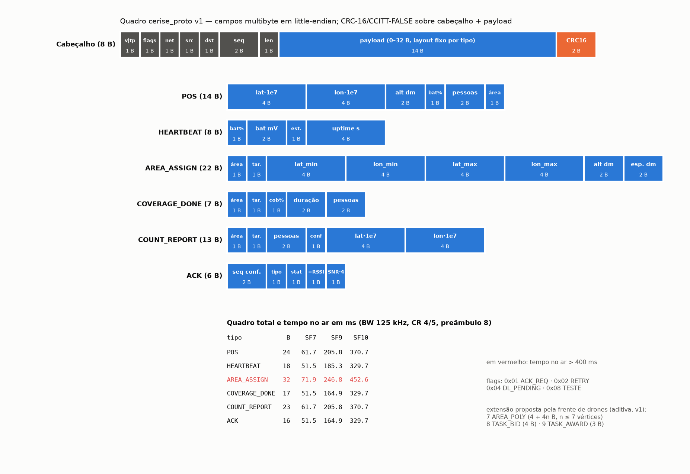

### 4.2 Firmware dos papéis *node* e *gateway*

O **nó** (lado drone) gera telemetria `POS` a cada 5 s com variação aleatória de ±10 % (para desfazer o sincronismo
entre drones), um `HEARTBEAT` a cada seis ciclos, `COUNT_REPORT` quando a contagem cresce e `COVERAGE_DONE` ao fim da
área. Cada mensagem recebe um número de sequência; a retransmissão reutiliza o número e sinaliza a flag `RETRY`. O nó
espera o ACK por ToA(ACK) + 160 ms e repete até três vezes, com recuo aleatório uniforme em
[0, (ToA + espera do ACK)·2ᵏ]; antes de cada transmissão executa detecção de atividade no canal (CAD) e bloqueia
quadros acima de 400 ms. A posição vem, em ordem de prioridade, do computador de bordo (comando serial `POS`), de um
GPS opcional (`-DUSE_GPS`) ou de uma trajetória em zigue-zague sintética. O **gateway** valida o CRC da camada
física e o CRC16 do protocolo, descarta tráfego de outras redes, detecta duplicatas por origem, responde ACK com
RSSI/SNR, estima a PDR por nó pelas lacunas de sequência, entrega downlinks `AREA_ASSIGN` logo após o ACK (flag
`DL_PENDING`) e imprime uma linha JSON por evento na serial, além do status no OLED. Ambos aceitam o comando `TX <hex>`
para transmitir quadros já codificados pelo software da frente de drones. A Figura 2 resume a troca de mensagens.

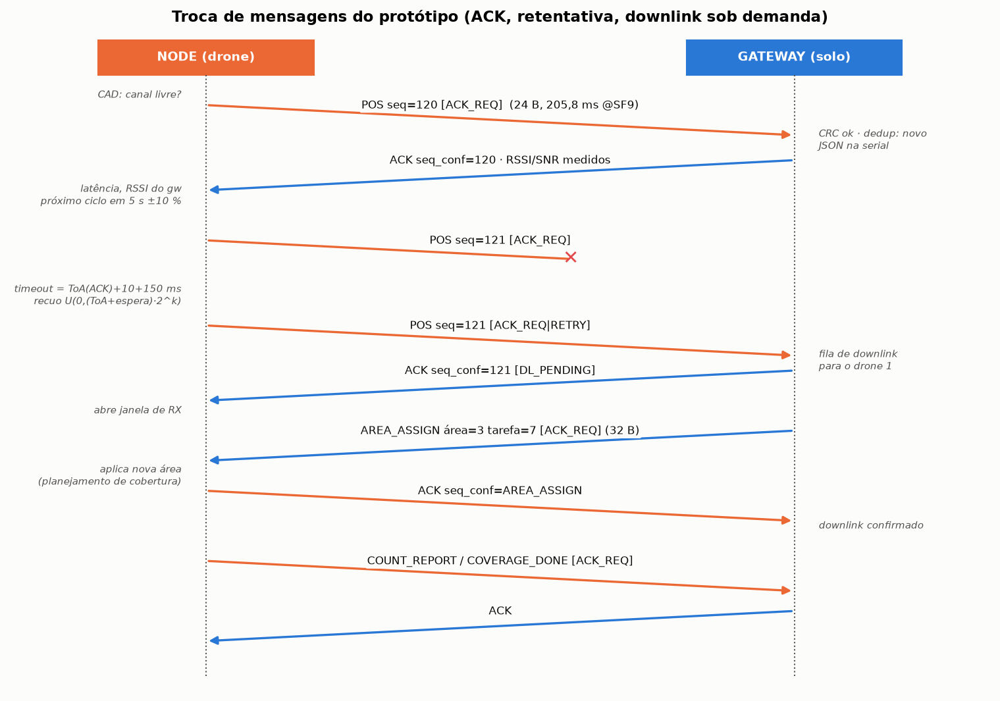

### 4.3 Ferramentas de análise

- `tools/lora_calc.py`: tempo no ar por mensagem e SF, maior quadro permitido em 400 ms, sensibilidade, perda
  máxima admissível (MAPL) e alcance pelos três modelos.
- `tools/sim_canal.py`: simulação de eventos discretos com gateway *half-duplex* de um demodulador, colisão
  destrutiva (efeito captura opcional), perda de ACK por interferência, perda independente por desvanecimento
  (PER) e fila de uma posição por drone. Esquemas: ALOHA puro, ALOHA + ACK (com recuo dimensionado e com recuo
  curto ToA·2ᵏ), CSMA/CAD + ACK, *slotted* ALOHA e TDMA + ACK com slots sincronizados por GPS.
- `tools/gateway_dashboard.py`: leitor serial (qualquer porta ou URL do pyserial) que grava CSV/JSONL, calcula a
  PDR por drone de forma independente do gateway e gera um painel; testado com `tools/sim_serial_gateway.py`,
  que emula a saída serial do gateway com o caminho real de codificação/decodificação dos quadros.

### 4.4 Hardware e projeto do módulo definitivo

A lista de materiais (`hardware/BOM.csv`) prevê 2 × Heltec V3, antenas de 915 MHz (3 dBi no solo, dipolo de 2 dBi no
drone), *pigtails* U.FL–SMA, baterias LiPo 1S, GPS opcional para o ensaio de alcance e, para o módulo definitivo,
BEC de 5 V e chicote JST-GH. No módulo definitivo o rádio atua como modem do computador de bordo (UART 3,3 V em
GPIO47/48, 115200 bps, mesmos comandos e log JSON), independente da controladora de voo (Figura 3). Os requisitos
de massa, energia, fixação, posição da antena, gabinete e regulamentação estão em
`hardware/requisitos_modulo_drone.md`; o gabinete paramétrico é apresentado na Figura 4.

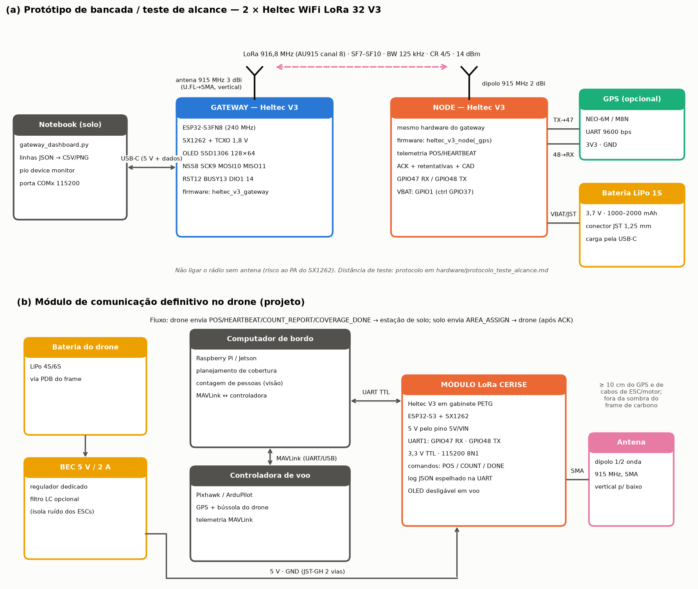

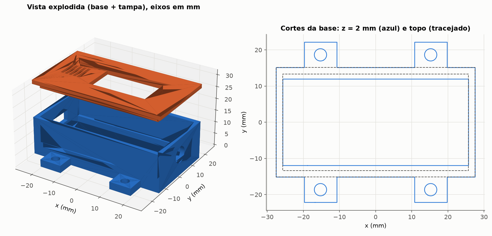

## 5. Resultados

### 5.1 Verificação do protocolo

Os 30 testes unitários nativos passaram (Figura 5), cobrindo: valor de verificação do CRC ("123456789" → 0x29B1);
ida e volta de todos os nove tipos; vetor de referência do `POS` calculado de forma independente em Python; detecção
de todos os erros de 1 bit (192 casos), de 2 bits (18 336 combinações) e de rajadas de até 16 bits (2 952 casos) em
um quadro de 24 B; rejeição de versão, tipo, tamanho e argumentos inválidos; ACK com saturação de RSSI/SNR;
duplicatas com volta do contador; tempo no ar contra valores de referência (13 B em SF7 = 46,336 ms); plano AU915;
e formatação JSON. Os 21 testes em Python (Figura 6) confirmaram igualdade byte a byte entre C e Python nos 3 000
quadros válidos, nas 3 000 linhas JSON e nas 9 360 combinações de tempo no ar; os 3 000 quadros com 1 a 4 bits
distintos invertidos foram todos rejeitados, com o mesmo código de erro nas duas implementações.

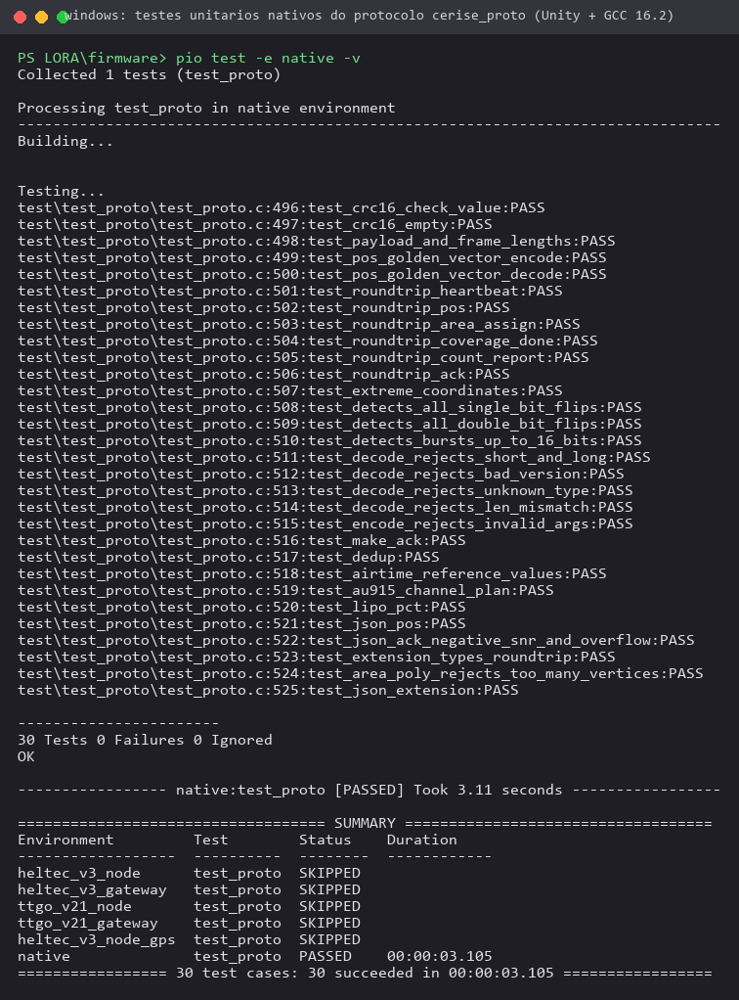

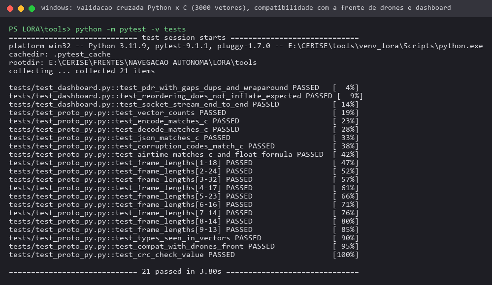

### 5.2 Compilação do firmware

Os cinco ambientes compilaram sem avisos (Figura 7). O gateway usa mais RAM por manter estatísticas e a tabela de
duplicatas de 256 origens.

| Ambiente | Placa | RAM (bytes) | RAM (%) | Flash (bytes) | Flash (%) |
|---|---|---:|---:|---:|---:|
| heltec_v3_node | Heltec V3 (ESP32-S3 + SX1262) | 22 400 | 6,8 | 376 241 | 11,3 |
| heltec_v3_gateway | Heltec V3 | 30 552 | 9,3 | 355 821 | 10,6 |
| heltec_v3_node_gps | Heltec V3 + GPS | 22 552 | 6,9 | 378 489 | 11,3 |
| ttgo_v21_node | TTGO LoRa32 v2.1 (ESP32 + SX1276) | 25 228 | 7,7 | 376 277 | 28,7 |
| ttgo_v21_gateway | TTGO LoRa32 v2.1 | 33 424 | 10,2 | 358 045 | 27,3 |

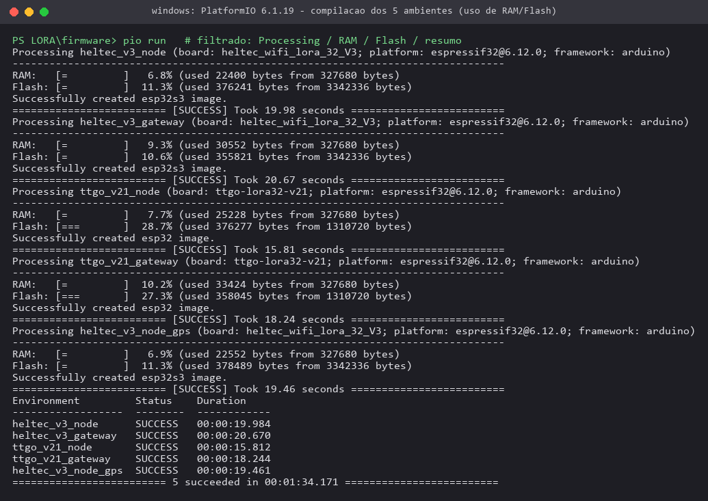

### 5.3 Tempo no ar

| Mensagem | Quadro (B) | SF7 (ms) | SF8 | SF9 | SF10 | SF11 | SF12 |
|---|---:|---:|---:|---:|---:|---:|---:|
| HEARTBEAT | 18 | 51,5 | 92,7 | 185,3 | 329,7 | 659,5 | 1 318,9 |
| POS | 24 | 61,7 | 113,2 | 205,8 | 370,7 | 823,3 | 1 482,8 |
| AREA_ASSIGN | 32 | 71,9 | 133,6 | 246,8 | 452,6 | 987,1 | 1 810,4 |
| COVERAGE_DONE | 17 | 51,5 | 92,7 | 164,9 | 329,7 | 659,5 | 1 318,9 |
| COUNT_REPORT | 23 | 61,7 | 113,2 | 205,8 | 370,7 | 823,3 | 1 482,8 |
| ACK | 16 | 51,5 | 92,7 | 164,9 | 329,7 | 659,5 | 1 318,9 |

(BW 125 kHz, CR 4/5, preâmbulo de 8 símbolos, cabeçalho explícito, CRC ligado.) Sob o limite de 400 ms, o maior
quadro admissível é de 255 B em SF7, 138 B em SF8, 66 B em SF9 e 24 B em SF10; SF11 e SF12 não comportam nenhum
quadro. Todas as mensagens do drone cabem até SF10; o `AREA_ASSIGN` (downlink) deve ser enviado em SF ≤ 9. Com POS a
cada 5 s, a ocupação do canal por drone é de 1,23 % (SF7), 4,12 % (SF9) e 7,41 % (SF10) (Figura 8).

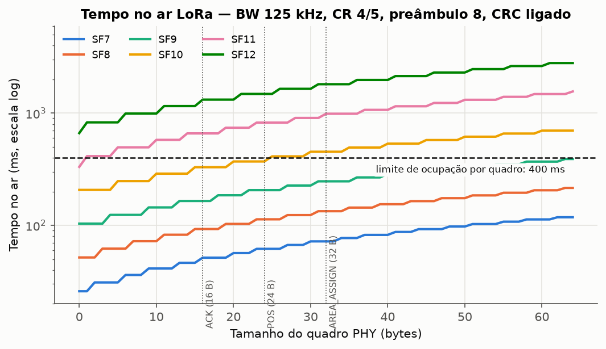

### 5.4 Orçamento de enlace e alcance estimado

Com 14 dBm, antenas de 2 dBi (drone) e 3 dBi (solo), 1,5 dB de perdas em cabos e conectores e margem de 10 dB, a
perda máxima admissível vai de 132,0 dB (SF7) a 144,5 dB (SF12). Os alcances estimados para o drone a 60 m e a
antena de solo a 2 m estão na tabela e na Figura 9; o efeito da altitude aparece na Figura 10.

| SF | Sensibilidade (dBm) | MAPL (dB) | Log-dist. n=2,7 (km) | Log-dist. n=3,5 (km) | Hata aberto (km) | Hata suburbano (km) | Hata urbano (km) |
|---|---:|---:|---:|---:|---:|---:|---:|
| 7 | −124,5 | 132,0 | 5,21 | 0,74 | 15,35 | 4,24 | 2,12 |
| 8 | −127,0 | 134,5 | 6,44 | 0,87 | 18,25 | 5,04 | 2,52 |
| 9 | −129,5 | 137,0 | 7,97 | 1,02 | 21,70* | 5,99 | 3,00 |
| 10 | −132,0 | 139,5 | 9,87 | 1,21 | 25,81* | 7,12 | 3,57 |
| 11 | −134,5 | 142,0 | 12,21 | 1,42 | 30,68* | 8,47 | 4,24 |
| 12 | −137,0 | 144,5 | 15,12 | 1,68 | 36,48* | 10,07 | 5,04 |

\* fora da faixa de validade de Okumura–Hata (1–20 km). O modelo de espaço livre resulta em 104–439 km, acima do
horizonte rádio de 37,7 km (k = 4/3) para 60 m/2 m; na prática o alcance com visada é limitado pelo horizonte e pela
liberação da primeira zona de Fresnel (raio no meio do enlace de 9,0 m a 1 km, 20,2 m a 5 km e 28,6 m a 10 km), o
que favorece o drone em altitude: no modelo suburbano em SF9, o alcance passa de 4,13 km a 30 m para 5,99 km a 60 m
e 9,11 km a 120 m. Esses valores são estimativas de projeto, a confirmar no ensaio de campo.

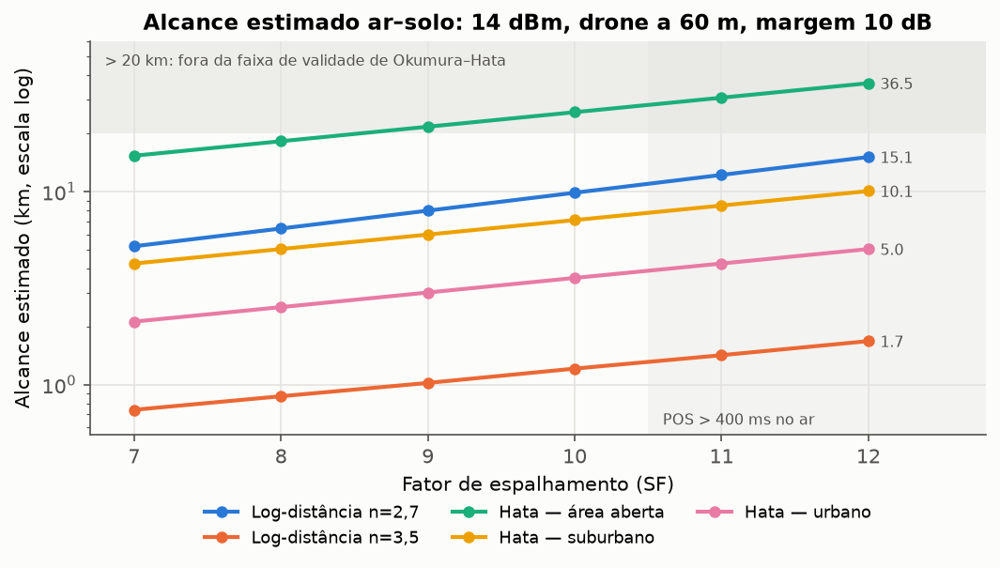

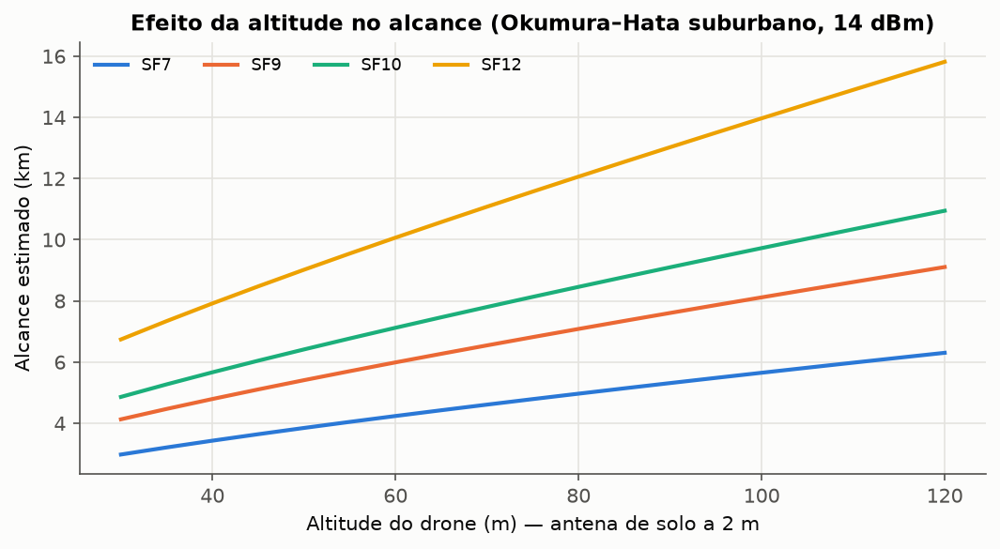

### 5.5 Compartilhamento do canal por vários drones (simulação)

Foram realizadas 1 130 execuções (5 sementes × 1 800 s simulados por configuração). O simulador reproduziu a teoria do
ALOHA puro com chegadas de Poisson, P = exp(−2(N−1)·ToA/T), com erro absoluto médio de 0,56 p.p. e máximo de
1,47 p.p. entre N = 2 e 20 (Figura 13, à esquerda). Os resultados para SF9 e POS a cada 5 s estão na tabela
(PDR média ± desvio entre sementes e latência média) e na Figura 11.

| N | ALOHA puro | ALOHA + ACK | ALOHA + ACK, recuo curto | CSMA/CAD + ACK | Slotted ALOHA | TDMA + ACK |
|---:|---|---|---|---|---|---|
| 2 | 91,1 ± 2,5 % · 206 ms | 99,7 ± 0,2 % · 488 ms | 98,9 ± 0,2 % · 367 ms | 100,0 % · 243 ms | 93,0 ± 2,4 % · 316 ms | 100,0 % · 605 ms |
| 5 | 71,4 ± 2,1 % · 206 ms | 67,6 ± 1,4 % · 2 790 ms | 61,8 ± 1,2 % · 1 198 ms | 100,0 % · 417 ms | 83,7 ± 2,6 % · 314 ms | 100,0 % · 1 214 ms |
| 8 | 54,5 ± 1,0 % · 206 ms | 26,6 ± 0,6 % · 4 123 ms | 20,8 ± 0,7 % · 1 469 ms | 97,9 ± 0,8 % · 1 229 ms | 72,8 ± 1,9 % · 313 ms | 100,0 % · 1 810 ms |
| 10 | 46,0 ± 1,5 % · 206 ms | 15,1 ± 0,4 % · 4 356 ms | 10,0 ± 0,3 % · 1 536 ms | 62,6 ± 0,5 % · 4 096 ms | 67,2 ± 1,2 % · 313 ms | 100,0 % · 2 214 ms |
| 12 | 38,4 ± 1,2 % · 206 ms | 8,1 ± 0,5 % · 4 526 ms | 4,8 ± 0,1 % · 1 606 ms | 44,0 ± 0,3 % · 5 068 ms | 61,0 ± 1,0 % · 314 ms | 100,0 % · 2 699 ms |
| 15 | 30,1 ± 0,9 % · 206 ms | 3,2 ± 0,2 % · 4 543 ms | 1,4 % · 1 596 ms | 26,5 ± 0,3 % · 5 837 ms | 54,2 ± 0,7 % · 314 ms | 83,5 ± 0,1 % · 8 289 ms |
| 20 | 19,2 ± 0,4 % · 206 ms | 0,7 % · 4 342 ms | 0,3 % · 1 566 ms | 11,2 ± 0,2 % · 6 579 ms | 43,7 ± 0,7 % · 314 ms | 62,6 % · 10 305 ms |

Três conclusões orientam o projeto. Primeiro, **ACK com retransmissão no mesmo canal piora o desempenho sob carga**:
cada ACK ocupa o canal por 164,9 ms (SF9) e o gateway fica surdo enquanto transmite, de modo que com 10 drones a
ocupação somada chega a 145 % (transmissões sobrepostas) e a PDR cai para 15,1 %, contra 46,0 % sem ACK; o recuo
curto (ToA·2ᵏ, valor inicial do firmware) agrava o problema porque as retransmissões dos nós que colidiram voltam a
colidir — a simulação motivou a mudança do recuo no firmware para (ToA + espera do ACK)·2ᵏ. Segundo, **escutar antes
de transmitir (CAD)** mantém PDR ≥ 97,9 % até 8 drones em SF9, mas também satura acima disso. Terceiro, **TDMA com
slots sincronizados por GPS** entrega 100 % enquanto N·slot ≤ período (slot de 401 ms em SF9 → até 12 drones a cada
5 s), ao custo de latência da ordem de meio quadro TDMA; acima da capacidade a PDR cai para ≈ T/(N·slot). A redução
do SF amplia a capacidade (Figura 12): com 10 drones, SF7 dá PDR de 100 % para CSMA/CAD + ACK e TDMA + ACK, 93,4 %
para ALOHA + ACK e 80,0 % para ALOHA puro; em SF10 nem o TDMA atende 10 drones (68,7 %). Com perda independente por
desvanecimento (N = 5, Figura 13, à direita), os esquemas com ACK mantêm 95,3 % (CSMA/CAD) e 97,3 % (TDMA) mesmo com
PER = 30 %, enquanto o ALOHA puro cai de 71,4 % para 49,8 %. Com efeito captura de 6 dB, a PDR do ALOHA puro com
10 drones sobe de 46,0 % para 62,6 %, indicando que a tabela acima é conservadora.

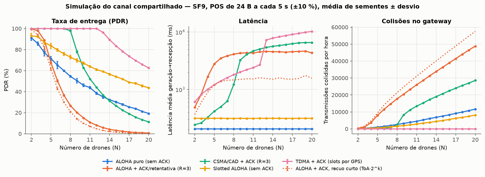

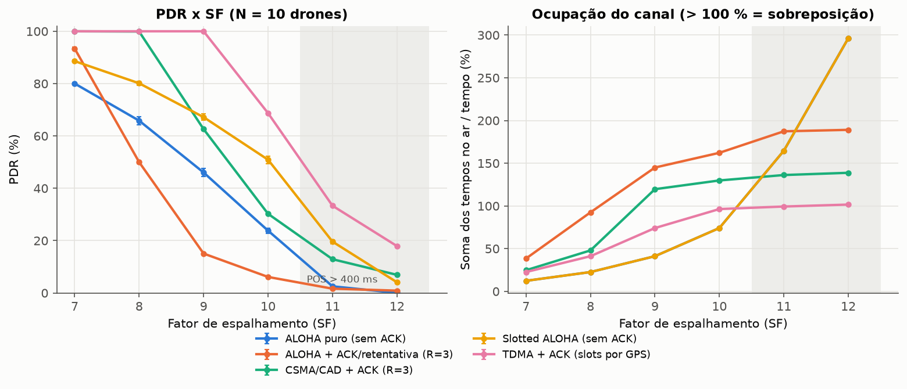

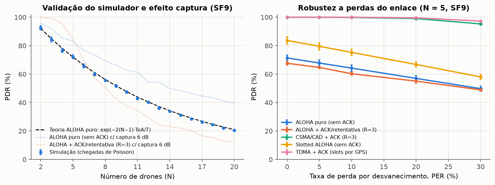

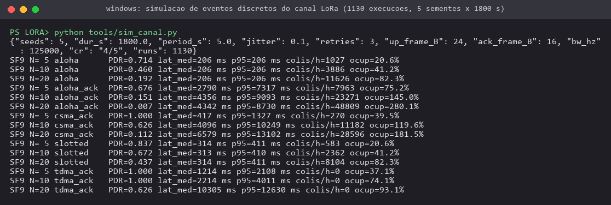

### 5.6 Dashboard do gateway com fluxo serial simulado

O leitor serial foi exercitado com 600 s simulados (acelerados 10×) de três drones a 1,0 km, 4,6 km e 6,4 km da
estação de solo, com canal sintético (log-distância n = 3, sombreamento de 4 dB, colisões e 10 % de perda de ACK).
Foram lidas 593 linhas sem nenhuma linha inválida (432 pacotes, 100 erros de CRC da camada física); a PDR calculada
pelas lacunas de sequência coincidiu com a reportada pelo gateway simulado: 98,6 % (137/139), 97,8 % (135/138) e
94,8 % (129/136), com RSSI médio de −106,7, −122,8 e −125,0 dBm (Figuras 15 e 16). Esse teste valida o software de
registro e análise; os números de enlace são do canal sintético, não de medição em campo.

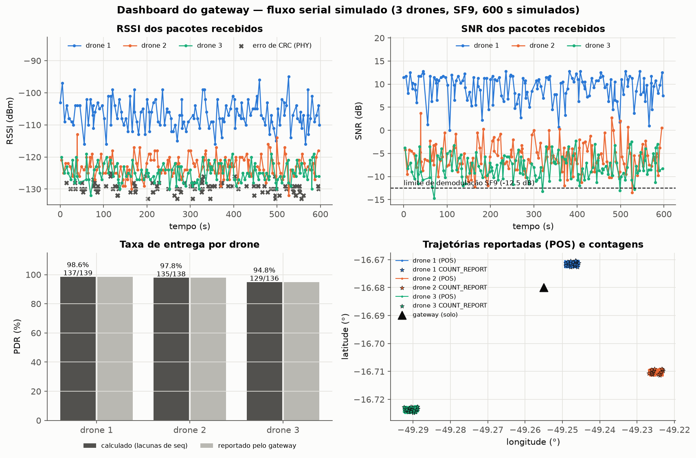

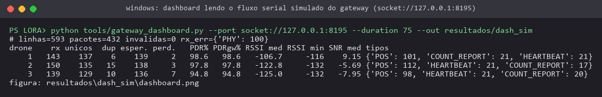

### 5.7 Gabinete, massa e energia (estimativas de projeto)

O gabinete paramétrico resultou em dimensões externas de 55,0 × 44,3 × 17,2 mm (com orelhas e tampa) e internas de
51,4 × 26,7 × 14,0 mm; as malhas da base (7,68 cm³) e da tampa (2,45 cm³) são estanques, o que corresponde a 12,9 g
de PETG com preenchimento total (limite superior). Com correntes típicas de datasheet do SX1262 (RX 4,6 mA; TX
45 mA a 14 dBm e 118 mA a 22 dBm) e a hipótese de 40 mA para o ESP32-S3 com Wi-Fi/BLE desligados, o consumo médio
estimado do módulo fica entre 0,23 W e 0,34 W na entrada de 5 V (SF7–SF10, com e sem OLED), ou 0,11–0,17 % da
potência média de voo de um multirrotor de ~200 W. Esses valores devem ser substituídos por medições com o protótipo.

## 6. Repositório

Código, testes, ferramentas, figuras e resultados: repositório `cerise-2026-lora-prototipo` da organização do
CERISE no GitHub. Os arquivos de métricas citados neste texto estão em `resultados/` (CSV/JSON/logs) e as figuras em
`evidencias/`; os binários compilados estão em `firmware/binarios/` e os arquivos de depuração da compilação
(ELF/MAP), no Release descrito em `RELEASES.md`.

## 7. Limitações

- **Nenhum ensaio físico foi realizado**: os módulos ainda não foram adquiridos. Firmware e protocolo foram
  verificados por compilação, testes unitários nativos e validação cruzada; o comportamento de rádio (RSSI, SNR, PDR
  real, alcance, temporização do ACK) não foi medido.
- Alcances e consumo são estimativas por modelos e por valores típicos de datasheet; a sensibilidade usada é teórica.
- A simulação usa modelo conservador de colisão (sem captura, salvo na análise específica), ACK perdido por qualquer
  sobreposição e sincronismo ideal no TDMA.
- O protótipo opera em canal único; a conformidade plena ao Ato 14.448 requer salto de frequência (≥ 35 canais) ou
  enquadramento como modulação digital, além da homologação. As alterações posteriores do Ato não foram verificadas.
- O protocolo não possui cifragem nem autenticação: um transmissor qualquer poderia injetar um `AREA_ASSIGN`; o
  identificador de rede não é mecanismo de segurança.
- As dimensões da placa Heltec V3 usadas no gabinete (50,2 × 25,5 mm) devem ser conferidas com paquímetro antes da
  impressão.

## 8. Próximos passos e pendências

1. **Aquisição** de 2 × Heltec V3 e antenas (`hardware/BOM.csv`) e **gravação** (`pio run -e heltec_v3_gateway -t upload`,
   `pio run -e heltec_v3_node -t upload`); conferências de bancada e ensaio de alcance/PDR conforme
   `hardware/protocolo_teste_alcance.md` (200 quadros por ponto, 50 m a 3 km, SF7/9/10).
2. Medição de consumo e massa reais; impressão e ajuste do gabinete.
3. Implementação do **TDMA sincronizado por GPS** e de ACK seletivo (apenas mensagens críticas), conforme a simulação.
4. Salto de frequência sobre os canais AU915 e encaminhamento da homologação.
5. Cifragem/autenticação (AES-128-CCM) com o número de sequência no *nonce*.
6. Integração com o computador de bordo da frente de drones pela UART (comandos e log JSON já definidos; tipos
   `AREA_POLY`/`TASK_BID`/`TASK_AWARD` já suportados e testados).
